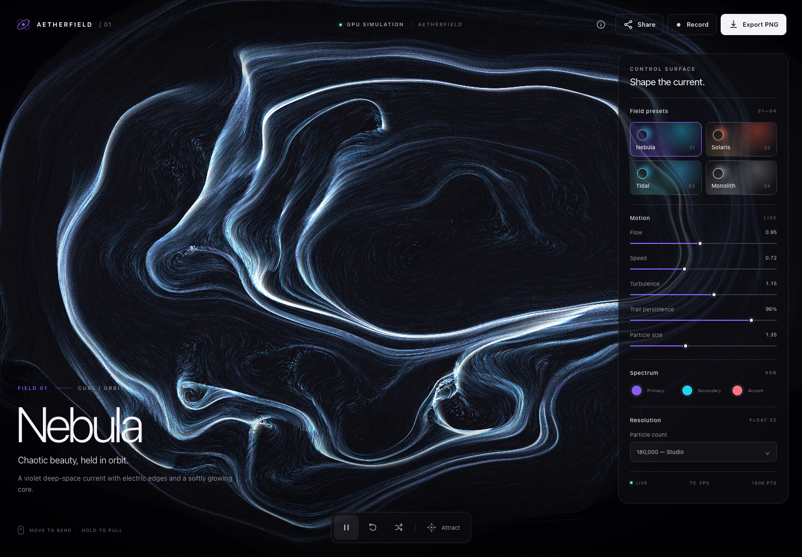
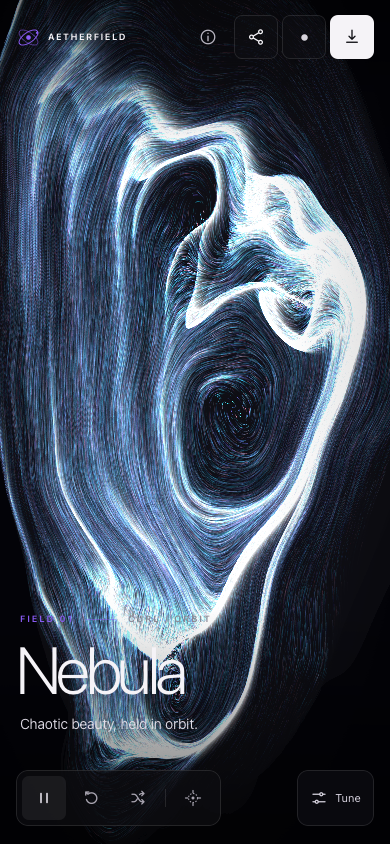

<div align="center">

# Aetherfield

**A real-time GPU particle studio for generative art — an experiment built by an AI model.**

[**▶ Open the live demo**](https://videogameoutlaw.github.io/aetherfield/)


</div>

> **This is a concept, not a product.** Aetherfield was an experiment to see how far Kimi 3.1 Pro could take a single idea — a browser-based particle studio — starting from a one-shot prompt and then testing and refining its own work. The code, the tests, and most of this README were written by the model. It is published as-is for anyone curious about the result; it is not maintained and there is no roadmap.

Aetherfield turns a browser canvas into a small, controllable universe. Every particle is simulated on the GPU, every preset has its own physical character, and every field can be reproduced from a compact share link.

Built with native JavaScript, WebGL2, and CSS. No framework and no runtime dependencies.



## Highlights

- **Actual GPU physics** — position and velocity textures advance through a fragment shader; this is not a prerecorded animation or a CPU particle loop.
- **180,000 particles by default** — selectable counts of 60,000, 120,000, 180,000, or 262,144, packed into square GPU textures.
- **Four distinct fields** — Nebula, Solaris, Tidal, and Monolith combine different curl, radial, flow, and ordered-orbit dynamics.
- **Cinematic rendering** — additive point sprites, temporal trails, procedural starlight, per-particle lifetimes, and preset-specific color palettes.
- **A live instrument panel** — tune flow, speed, turbulence, trail persistence, point size, palette, and particle count without reloading.
- **Direct interaction** — move the pointer to bend the field, hold to increase force, and switch between attraction and repulsion.
- **Deterministic starting conditions** — seeded PRNG initialization and defensive settings validation make fields portable and reproducible.
- **Real exports** — download the current canvas as PNG or record a real video with `MediaRecorder`.
- **Shareable fields** — versioned, URL-safe settings encode the preset, seed, physics, palette, and particle count.
- **Responsive and accessible** — desktop instrument panel, mobile bottom sheet, keyboard controls, focus states, reduced-motion support, and touch-sized mobile controls.

## Run locally

Requires Node.js 20 or newer.

```bash
npm install
npm run dev
```

Open the local URL printed by Vite. To create and serve a production build:

```bash
npm run build
npm run preview
```

The production site is emitted to `dist/` and can be hosted on any static web host.

## Controls

| Input | Action |
| --- | --- |
| Pointer movement | Bend the nearby particle field |
| Hold pointer / touch | Increase interaction strength |
| `Space` | Pause or resume the simulation |
| `R` | Restart from the current seed |
| `N` | Generate and load a new random seed |
| `H` | Hide or restore the interface |
| `F` | Enter or exit fullscreen |
| `1`–`4` | Select Nebula, Solaris, Tidal, or Monolith |
| `?` | Open the field guide |

Use **Tune** on mobile to open the control sheet. **Share** copies a field URL when the Clipboard API is available and otherwise leaves the share URL in the address bar.

## The fields

| Preset | Character |
| --- | --- |
| **Nebula** | Violet, cyan, and rose currents curl around a chaotic orbital core. |
| **Solaris** | Warm radial forces pull a stellar disc toward collapse. |
| **Tidal** | Cool layered currents move like an ocean without a surface. |
| **Monolith** | Silver orbital bands trade color and chaos for a sharper, ordered current. |

Each preset is a starting point rather than a locked theme. Physics and palette controls remain live after selection.

## Mobile

The interface becomes a compact gallery view with a scrollable control sheet rather than squeezing the desktop panel onto a small screen.



## Why JavaScript + GLSL

Aetherfield uses the language best suited to each layer rather than forcing the entire project into one stack. **GLSL executes the particle simulation and rendering directly on the GPU**, while native JavaScript handles browser APIs, UI state, sharing, and exports. JavaScript never loops over the 180,000 particles during a frame.

Rust/WASM or C++ would not accelerate the GPU shaders and would introduce an additional compilation and interoperability layer for code that is not the bottleneck. WebGL2 also provides broad browser support without requiring a framework or runtime package.

Performance is designed into the architecture:

- Ping-pong floating-point textures keep simulation state on the GPU.
- Additive point sprites and temporal trails avoid CPU geometry generation.
- Device pixel ratio is capped to control fill-rate cost on dense displays.
- Paused fields use render-on-demand instead of issuing identical GPU frames; playback, recording, control changes, restarts, and resizes invalidate rendering normally.
- Production assets are minified into a small, dependency-free static bundle.

## Architecture

```text
src/
├── engine/
│   ├── particle-data.js     # Seeded position/velocity texture initialization
│   ├── particle-engine.js   # WebGL2 resources, ping-pong simulation, rendering
│   └── shaders.js           # Simulation, particle, trail, and fullscreen shaders
├── lib/
│   ├── export-utils.js      # Portable filenames and recorder format selection
│   ├── prng.js              # Seed normalization and deterministic PRNG
│   └── settings.js          # Presets, validation, URL-safe serialization
├── main.js                  # UI wiring, playback, sharing, capture, input
└── style.css                # Responsive visual system
```

### Rendering pipeline

1. Seed two floating-point textures with initial position/life and velocity/age data.
2. Advance both textures through the simulation fragment shader.
3. Swap ping-pong framebuffers for the next step.
4. Render particles as additive point sprites, reading their latest state from texture coordinates.
5. Fade the previous frame and composite procedural background light for persistent trails.

The renderer caps device pixel ratio to control GPU cost and clamps long frame deltas to keep returning tabs stable. If WebGL2 floating-point render targets are unavailable, the app shows an explicit compatibility message instead of a blank canvas.

### Sharing and reproducibility

A share payload contains a version, preset ID, normalized seed, physics values, point size, particle count, and palette. It is serialized as UTF-8 JSON and encoded with unpadded base64url. Invalid or hostile values are rejected or clamped before reaching the renderer.

The seed and settings reproduce the same initial particle buffers. Exact pixels can still vary across GPUs because floating-point execution and blending precision are implementation-dependent.

### Export behavior

- **PNG** uses the canvas’s actual render resolution, including its device-pixel-ratio scaling.
- **Video** records the live canvas at 60 FPS request rate using the first browser-supported format from VP9 WebM, VP8 WebM, generic WebM, then MP4.
- Filenames include the preset, sanitized seed, and a UTC timestamp.
- Clipboard and recording capabilities are feature-detected; unsupported actions produce a visible explanation.

## Verification

```bash
# Deterministic data, validation, serialization, and export helpers
npm test

# One-time browser installation
npx playwright install firefox

# Real WebGL2 rendering and interaction tests
npm run test:browser

# Production bundle
npm run build
```

The Firefox suite verifies nonblank GPU output and advancing frames, live physics and palette controls, pause behavior, real pointer force and pressure, complete shared-link restoration, real PNG/video downloads, keyboard controls, the About dialog and build credit, mobile controls, touch-target/viewport containment, reduced-motion behavior, render-on-demand invalidation, and the unsupported-WebGL fallback.

At the time of the experiment the model reported 6 unit tests and 10 browser tests passing along with a clean production build, plus desktop and mobile layout checks in Safari/WebKit. Treat those as the model's own results rather than a guarantee.

## Status

Experimental and unmaintained. It works on the hardware it was tried on, but it has not been tested widely, and issues or pull requests may go unanswered. Feel free to fork it and take the idea further.

## Browser support

Aetherfield requires **WebGL2 with renderable floating-point color buffers**. Current Firefox, Safari, and Chromium-family browsers generally provide the required APIs on supported hardware, but GPU/driver support ultimately determines availability. Video container support varies by browser; the app selects from formats the browser reports as supported.

## Notes

- Runtime application code has **zero third-party dependencies**. Vite and Playwright are development tools only.
- Reduced-motion users start with a paused field and can resume it deliberately.
- `window.aetherfield` exposes the current engine and read-only state snapshot for debugging and browser acceptance tests.
